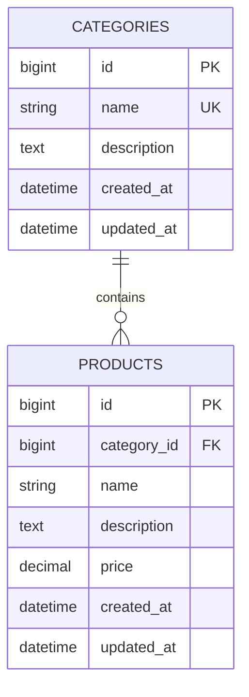

# Day 14 - Laravel Eloquent and Validation

A standalone Laravel API exercise demonstrating a Category–Product one-to-many relationship, Form Request validation, resource responses, pagination, factories, seeders, and feature tests.

The project also includes a native Blade admin interface for managing categories and products.

## Requirements

- PHP 8.3 or later with PDO SQLite enabled
- Composer

The project uses Laravel 13 and SQLite. No frontend or API authentication setup is required.

## Setup

From this directory:

```powershell
Remove-Item Env:COMPOSER -ErrorAction SilentlyContinue
composer install
Copy-Item .env.example .env
php artisan key:generate
New-Item -ItemType File -Force database/database.sqlite
```

Set `DB_CONNECTION=sqlite` in `.env` (the example already selects SQLite). Then create the schema and sample data:

```powershell
php artisan migrate
php artisan db:seed
```

To run the API locally:

```powershell
php artisan serve
```

Open the following pages:

| Page | URL |
| --- | --- |
| Dashboard | `http://127.0.0.1:8000/dashboard` |
| Categories | `http://127.0.0.1:8000/categories` |
| Create category | `http://127.0.0.1:8000/categories/create` |
| Products | `http://127.0.0.1:8000/products` |
| Create product | `http://127.0.0.1:8000/products/create` |

Bootstrap 5.3.3 is loaded from jsDelivr by the Blade layout, so the browser needs network access to render Bootstrap styling.

## Blade frontend architecture

- `routes/web.php` defines the HTML routes and uses the `web.` route-name prefix to keep them separate from the JSON API route names.
- `app/Http/Controllers/Web` contains the dashboard, category, and product MVC controllers. The web forms reuse the existing category and product Form Requests so validation errors redirect back into the form with the old input.
- `resources/views/layouts/app.blade.php` provides the responsive Bootstrap sidebar, shared navigation, and flash/validation messages. The dashboard and resource views extend the layout; category and product forms use shared Blade partials.
- Web list pages query through Eloquent, eager-load relationships where needed, count related products, and paginate results.
- Every state-changing Blade form includes CSRF protection and Laravel method spoofing for `PUT` and `DELETE`.

The existing JSON API routes in `routes/api.php` and their response formats remain separate and unchanged.

Run the feature and unit test suites with:

```powershell
php artisan test
```

Tests use an in-memory SQLite database and do not require the seeded local database.

## API endpoints

All endpoints are under `/api` and return JSON.

| Method | Endpoint | Purpose |
| --- | --- | --- |
| `GET` | `/api/categories` | List categories with product counts |
| `GET` | `/api/categories/{id}` | Get a category and its products |
| `POST` | `/api/categories` | Create a category |
| `PUT/PATCH` | `/api/categories/{id}` | Update a category |
| `DELETE` | `/api/categories/{id}` | Delete a category |
| `GET` | `/api/products` | Paginated products with their categories |
| `GET` | `/api/products/{id}` | Get a product with its category |
| `POST` | `/api/products` | Create a product |
| `PUT` | `/api/products/{id}` | Replace a product |
| `PATCH` | `/api/products/{id}` | Partially update a product |
| `DELETE` | `/api/products/{id}` | Delete a product (204 response) |

Product creation and replacement require `category_id`, `name`, and `price`; partial updates validate only the supplied fields. The optional `description` may be a string or `null`. Prices must be non-negative and have at most two decimal places. A category ID that does not exist returns a JSON validation response with HTTP `422`; missing resources return `404`.

Product listings accept `per_page` and `page` query parameters. `per_page` defaults to 15 and is capped at 100. Paginated responses include Laravel's `links` and `meta` fields.

Example create request:

```json
{
  "category_id": 1,
  "name": "Desk Lamp",
  "description": "Adjustable reading lamp.",
  "price": "24.50"
}
```

Example create response:

```json
{
  "data": {
    "id": 1,
    "category_id": 1,
    "name": "Desk Lamp",
    "description": "Adjustable reading lamp.",
    "price": "24.50",
    "category": {
      "id": 1,
      "name": "Electronics"
    }
  }
}
```

Invalid validation response (HTTP `422`):

```json
{
  "message": "The category_id field is invalid.",
  "errors": {
    "category_id": ["The selected category_id is invalid."]
  }
}
```

## Relationship diagram



One category has many products. Each product belongs to one category through `products.category_id`.

See [docs/api-samples.md](docs/api-samples.md) for successful and validation-error JSON samples, and [docs/relationship-diagram.md](docs/relationship-diagram.md) for the ER diagram.
