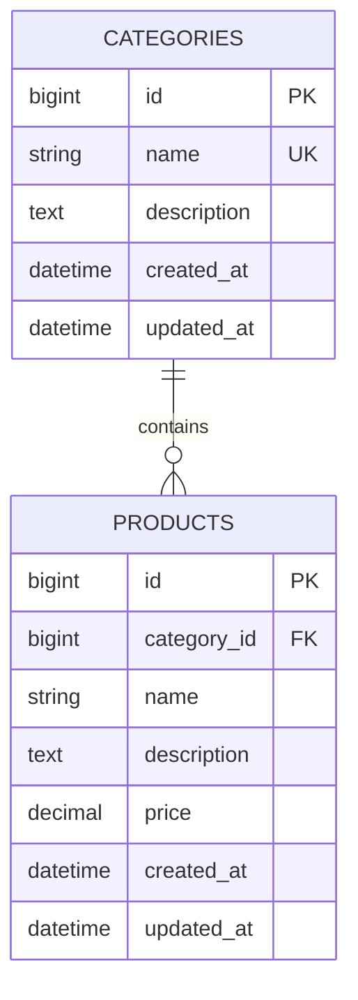

# Category–Product relationship

Each product belongs to exactly one category through the non-null `products.category_id` foreign key. A category may have zero or more products. Deleting a category cascades to its products at the database level.
