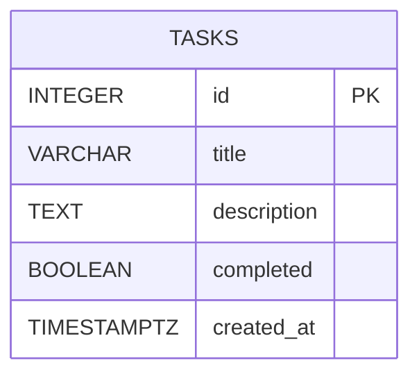

# Database design

## Database and table

The database is named `internship_tasks_db`. It contains a `public.tasks`
table representing the task resource exposed by the Day 8 Express API.

| Column | PostgreSQL type | Rules and purpose |
| --- | --- | --- |
| `id` | `INTEGER` | Identity-generated primary key |
| `title` | `VARCHAR(150)` | Required; cannot be blank or whitespace-only |
| `description` | `TEXT` | Required; defaults to an empty string |
| `completed` | `BOOLEAN` | Required; defaults to `FALSE` |
| `created_at` | `TIMESTAMPTZ` | Required; defaults to the current time |

The named primary key constraint is `tasks_pkey`; `tasks_title_not_blank`
rejects titles without any non-whitespace character. The database enforces a
maximum title length of 150 characters.

## Keys, identity, and constraints

`id` is the primary key, so each task has a unique, non-null identifier. Its
`GENERATED BY DEFAULT AS IDENTITY` definition uses PostgreSQL's identity
sequence to produce integer IDs when inserts omit `id`. The API should omit
`id` on create and use the returned database-generated ID. `BY DEFAULT` also
allows explicit values in controlled import scenarios, but normal application
inserts should not supply them.

- `NOT NULL` prevents a column from being stored without a value.
- `DEFAULT ''`, `DEFAULT FALSE`, and `DEFAULT NOW()` provide values when
  callers omit description, completion state, or creation time.
- `CHECK (title ~ '[^[:space:]]')` requires at least one non-whitespace title
  character. It complements `NOT NULL`: a non-null string can still be blank.

The API should continue trimming submitted titles, and should report a useful
validation error if a title exceeds 150 characters rather than exposing a
database error to its caller.

## Normalization

This table is a focused model for the current API and follows the core
normalization goals:

1. **First normal form (1NF):** each column holds a single value; task titles,
   descriptions, completion state, and timestamps are not stored as repeating
   lists or packed records.
2. **Second normal form (2NF):** the primary key is a single column, so there
   can be no dependency on only part of a composite key. Each non-key field
   describes the task identified by `id`.
3. **Third normal form (3NF):** non-key fields describe the task and do not
   depend on other non-key fields. If future features introduce users,
   categories, or labels, model those as related tables instead of duplicating
   their attributes across task rows.

## Transactions and ACID

The query examples demonstrate transactions with `BEGIN`, `COMMIT`, and
`ROLLBACK`. Transactions are useful when a request performs multiple related
database changes.

- **Atomicity:** all changes in a transaction succeed together or are rolled
  back together.
- **Consistency:** constraints and database rules remain true before and after
  a successful transaction.
- **Isolation:** concurrent transactions are kept from observing each other's
  incomplete work according to the selected isolation level.
- **Durability:** committed changes persist across process restarts and are
  protected by PostgreSQL's durability mechanisms.

## Indexing

The primary key automatically has a unique index, which supports task lookup
by `id`. The example `tasks_completed_created_at_idx` index is designed for
queries that filter by `completed` and order by `created_at`. Indexes can
speed up reads, but consume storage and add work to inserts and updates; use
`EXPLAIN` and representative data to check whether an index benefits actual
workloads.

## Why `TIMESTAMPTZ`

`TIMESTAMPTZ` represents an instant in time and normalizes it internally.
PostgreSQL renders that instant using the current session time zone, avoiding
the ambiguity of storing a local wall-clock timestamp without a zone. The API
can serialize the value as an ISO 8601 timestamp (typically UTC, with `Z`) for
the existing `createdAt` response field.

## Day 8 Express API compatibility

The Day 8 API exposes task fields as `id`, `title`, `description`, `completed`,
and `createdAt`; this schema provides the same values, with the conventional
snake_case database column `created_at` mapped to API `createdAt`. The SQL
examples use `created_at AS "createdAt"` to show that mapping.

In Day 10, the API can replace the in-memory service with asynchronous
PostgreSQL operations while keeping its `/api/tasks` routes and JSON response
shape. Create operations should omit `id` and use `RETURNING`; list, get,
update, and delete operations can query by the integer primary key and map
returned rows to the existing API fields. The database check and length limit
should be reflected in API validation so invalid values receive consistent,
client-friendly errors.
